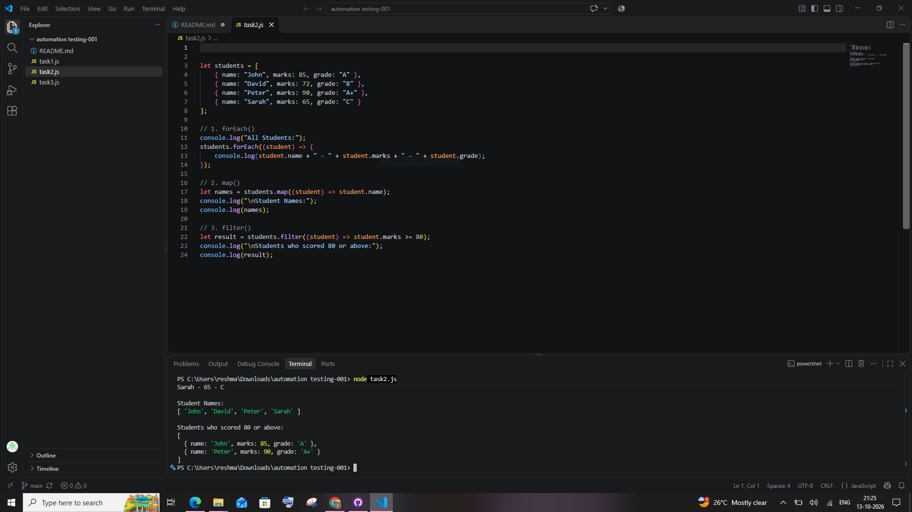
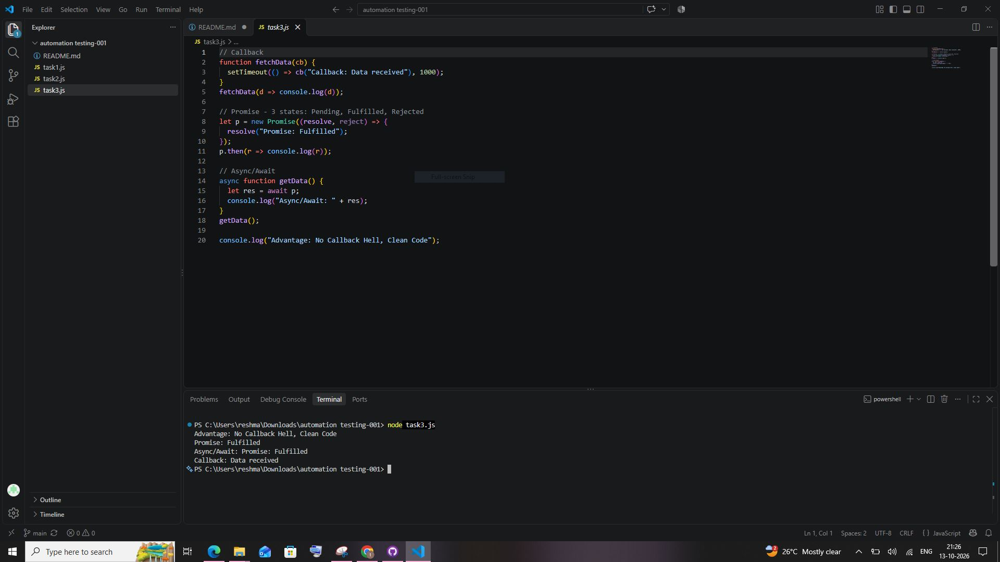

# Automation Testing Assignment - 001

### Task 1: Functions and Control Flow
**File Name: "task1.js"**
- Created a regular function "calculateResult(marks)".
- If marks are greater than or equal to 50, the result is Pass; otherwise, Fail.
- Created an arrow function "displayResult(name, result)".
- Used a "for...of" loop to display the results of all learners.

### Task 2: Arrays
**File Name: "array.js"**
- Used "forEach()" to display student details.
- Used "map()" to get student names.
- Used "filter()" to find students who scored 80 or above.

### Task 3: Asynchronous JavaScript

**1. Callback**
A callback is a function passed as an argument to another function and executed later.

**2. Promise**
A Promise represents the result of an asynchronous operation.
Promise has three states:
- Pending
- Fulfilled
- Rejected

**3. Async/Await**
Async/Await helps handle Promises in a simple and readable way.

**4. Advantage of Async/Await**
It makes asynchronous code easier to read and understand compared to nested callbacks.

### How to Run the Programs
Install Node.js.
Open the assignment folder in Visual Studio Code.
Open the terminal.
Run the following commands:javascript

node task1.js
node array.js

## Screenshots

