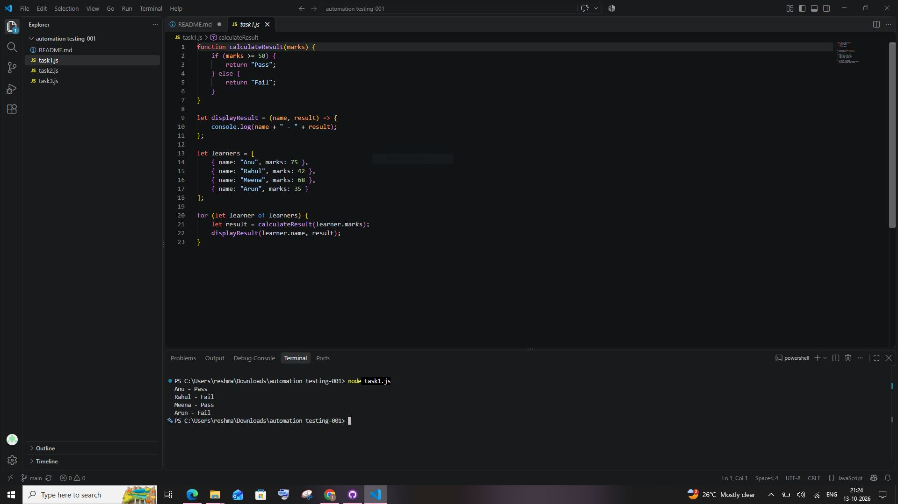

# automation-testing-001

## Task 1 - Functions, Arrow Functions & Control Flow
Regular function, Arrow function, Control flow explained with program.

## Task 2 - Arrays & Array Methods
forEach, map, filter explained and implemented.

## Task 3 - Asynchronous JS Theory
Callback, Promise (3 states), Async/Await and advantages explained.

## Screenshots

